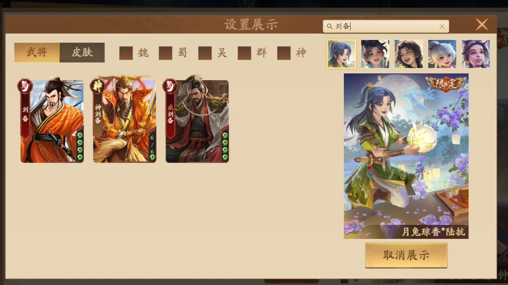
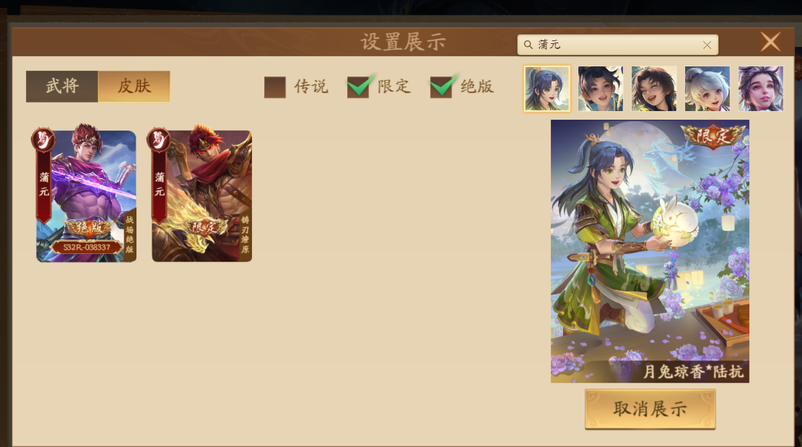
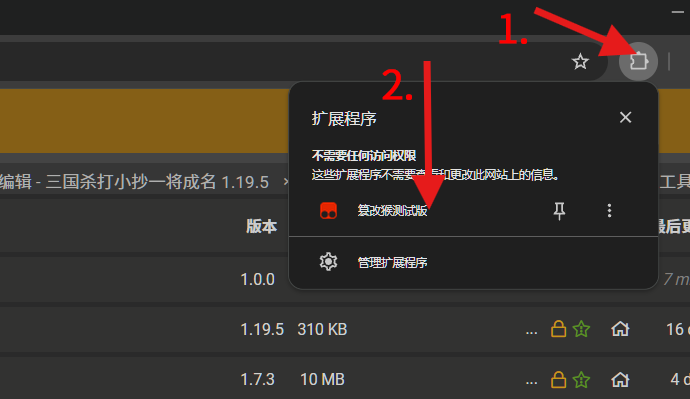
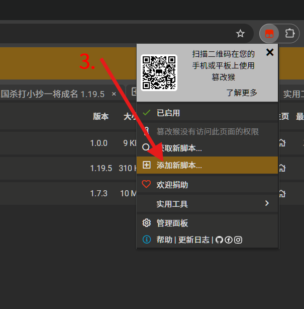
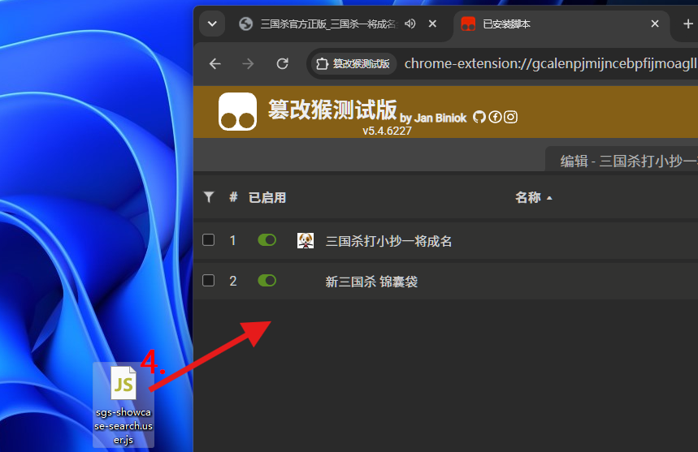
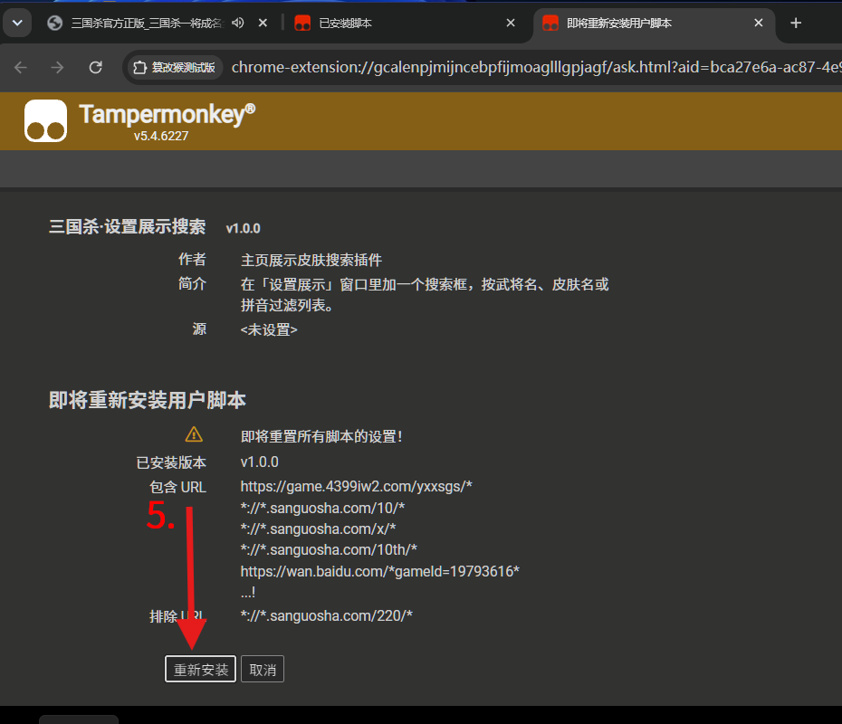
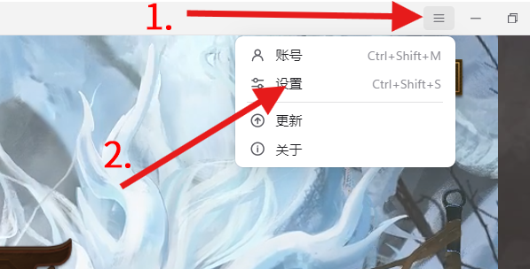
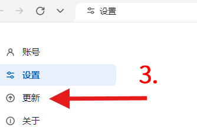
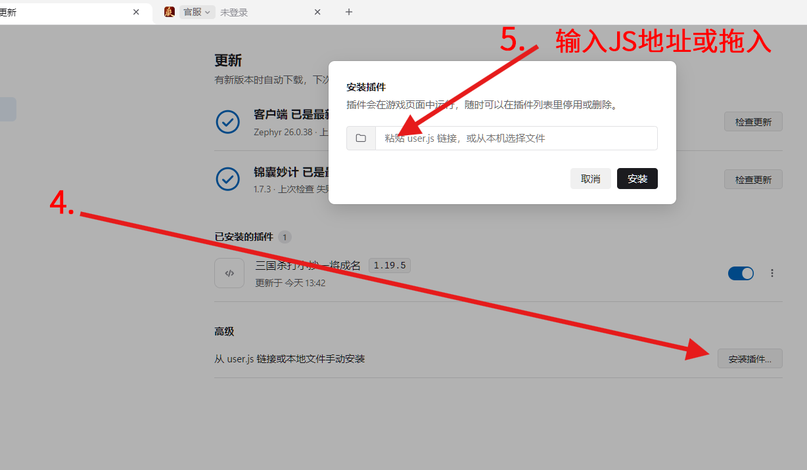

&nbsp;
&nbsp;
# 展示皮肤搜索

> [!NOTE]
>(๑•̀ㅂ•́)و✧ 这个插件只干一件事——往「设置展示」窗口里塞一个搜索框。

> [!WARNING]
>（使用前先看最后面的 <a href=#anchor_remind>==**小提醒&nbsp;·&nbsp;⚓**====(***特别是WARNING***)</a>)==

## 效果展示（==<a href=#anchor_use>点击直接看使用教程&nbsp;·&nbsp;👈</a>==）
	
>**搜索框&nbsp;·&nbsp;🔍**
>
>
>**武将检索** **&nbsp;&nbsp;&nbsp;——————————————&nbsp;&nbsp;** **皮肤检索（适配官方过滤）**
>
>&nbsp;&nbsp;&nbsp;

## 代码实现

>- 插件随游戏页加载，轮询 Laya 舞台，认出 `NewStyleUserInfoDisplaySettingWindow` 后挂一个 DOM 搜索框；位置按窗口坐标和画布缩放算，关窗自动收起。
>- 给「武将 / 皮肤」两个列表的 `UpdatePanel` 包了一层：先让游戏自己把完整数据算出来，再按搜索词过滤 `panel.DataProvider`。
>- 武将匹配 `generalName`、`searchkey`（自带拼音和别名）；皮肤匹配 `ItemName`、`Searchkey` 以及所属武将信息。
>- 中文和拉丁字母分段匹配，`陆抗lukang`、`月兔 陆抗` 都能用；多个词是「全都要满足」。
>- 切页、勾选势力/品质后都会重新套用搜索词，不会出现“清空后还是残血列表”的尴尬 (˘ω˘)

## 如何配置

>游戏里 个人信息 → 换展示 → 标题栏右侧搜索框；点 `×` 清空。
>>### 怎么安装与配置（默认已拥有插件）
>>&nbsp; 
>>**1.**
>>> **1.下载[tampermonkey](https://www.tampermonkey.net/)并确保其可用 （浏览器插件设置打开允许运行用户脚本）**
>>>
>>>**or 2. 下载[锦囊妙计客户端](https://github.com/Clarrycy/jinnangmiaoji)进行配置（<a href=#anchor_tutorial>教程👈</a>）**
>>>
>>>>**1.1**&nbsp;&nbsp;&nbsp;   &nbsp;&nbsp;**1.点击插件&nbsp;→&nbsp;2.点击篡改猴**
>>>>
>>>>**1.2**&nbsp;&nbsp;&nbsp;   &nbsp;&nbsp;**3.添加新脚本**
>>>>
>>>>**1.3**&nbsp;&nbsp;&nbsp;   &nbsp;&nbsp;**4.将js拖入篡改猴**
>>>>
>>>>**1.4**&nbsp;&nbsp;&nbsp;   &nbsp;&nbsp;**点击安装就完成了 · ✔️**
>>>&nbsp;
>>>&nbsp;
>>>**2.锦囊妙计微端安装**
>>>>**2.1**&nbsp;&nbsp;&nbsp;   &nbsp;&nbsp;**1.点击≡**(抽屉) **→ 2.设置**
>>>>**2.2**&nbsp;&nbsp;&nbsp;   &nbsp;&nbsp;**3.点击更新**
>>>>**2.3**&nbsp;&nbsp;&nbsp;   &nbsp;&nbsp;**4.点击安装插件&nbsp;→&nbsp;5.载入JS就好啦&nbsp;&nbsp;(p≧w≦q)**
>&nbsp;
---

## 小提醒	

>[!TIP]
>识别当前版本的游戏窗口类名；要是官方大改 UI，可能需要再对一次名字 
>
>>基于该项目上进行了自主开发及调试，未使用此开源项目代码。（[锦囊妙计客户端](https://github.com/Clarrycy/jinnangmiaoji)）&nbsp;(´･ω･`)

> [!WARNING]
>#### 一、非官方声明
>本插件由个人独立开发，与任何游戏官方、发行商、平台运营方无关联、无授权、无合作关系，不代表游戏官方立场，也未获得游戏官方的认可或背书。游戏中涉及的商标、版权及其他知识产权均归其各自权利人所有。
>
>
>#### 二、开源许可证与合规声明
>本插件在开发中使用了原项目的代码/资源，相关开源代码的著作权归原项目作者及其贡献者所有。
>
>
>如原项目许可证要求分发源码、相同方式共享、保留声明或提供修改说明，开发者应遵守相应义务。用户在使用本插件时，也应遵守原项目许可证及本插件许可证的约束。
>
>若本免责声明与原项目开源许可证存在冲突，就原项目代码部分而言，以原项目许可证为准。 本声明不构成对原项目许可证的修改或替代。
>
>#### 三、使用风险自担
>用户在使用本插件前，应自行了解所使用游戏平台的用户协议、插件政策及相关规定。是否使用本插件由用户自行判断并承担全部风险。
>
>因使用本插件可能导致的账号封禁、限制、数据丢失、虚拟财产损失、设备异常等后果，由用户自行承担，开发者不承担任何责任。
>
>本插件可能因游戏版本更新、平台政策调整、原项目停止维护等原因出现功能失效、兼容性问题或运行异常，开发者不保证插件的持续可用性、安全性或无错误运行。
>
>#### 四、免责条款
>在法律允许的最大范围内，开发者及原项目作者、贡献者均不对本插件作出任何明示或默示担保，包括但不限于适销性、特定用途适用性、不侵权及无错误的保证。因使用或无法使用本插件而产生的任何直接、间接、附带、特殊或后果性损失，开发者及原项目作者、贡献者均不承担赔偿责任。
>
>#### 五、知识产权与使用限制
>本插件中由开发者原创部分的著作权归开发者所有；原项目代码及资源的知识产权归其各自权利人所有。
>
>未经相应权利人许可，禁止对本插件进行反编译、逆向工程、恶意修改、二次分发或用于商业用途，但开源许可证明确允许的除外。
>
>用户不得利用本插件从事违反法律法规、侵犯他人权益、破坏游戏公平性或违反游戏平台规则的行为。
>
>#### 六、第三方内容
>本插件可能包含或调用第三方组件、库或服务，相关权利和责任由该第三方按其许可证或服务条款承担。开发者不对第三方内容的合法性、安全性作超出法律规定的保证。
>
>#### 七、条款变更与解释
>开发者保留随时修改本免责声明及插件功能的权力，修改后的条款自公布之日起生效。用户继续使用即视为接受变更后的条款。本声明由开发者负责解释，但不得违反适用法律及原项目开源许可证的强制性要求。
>
>#### 八、法律适用
>本声明适用[国家/地区]法律。因本声明引起的争议，双方应友好协商解决；协商不成的，提交[管辖地]有管辖权的机构处理。
>
>使用本插件即表示您已阅读、理解并同意上述全部条款。如不同意，请立即停止使用并删除本插件。
>
>#### 九、AI声明
> 项目使用人工智能辅助生成部分代码以及验证，包括但不限于部分`README.md`的文字、代码主体…
>
———————————————————————————————————————————————————————

>
<a href=#anchor_head>知道了</a>

&nbsp;
&nbsp;
&nbsp;
&nbsp;
&nbsp;

---

<a href="https://github.com/user7050030">© Tihaon7050030</a>

---